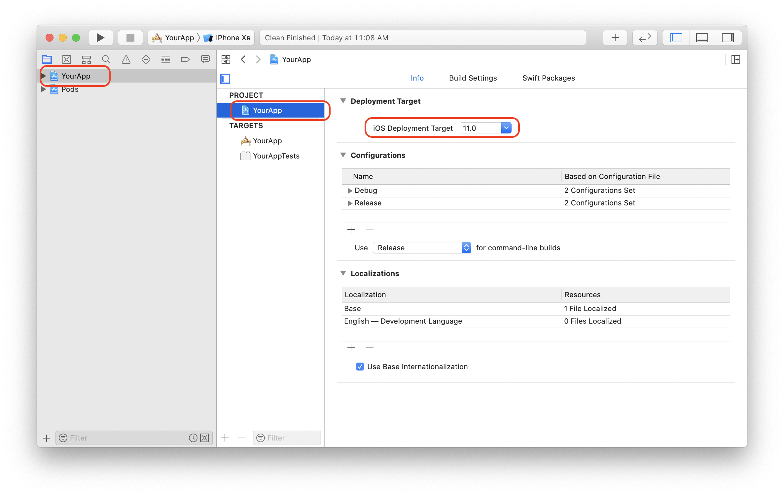
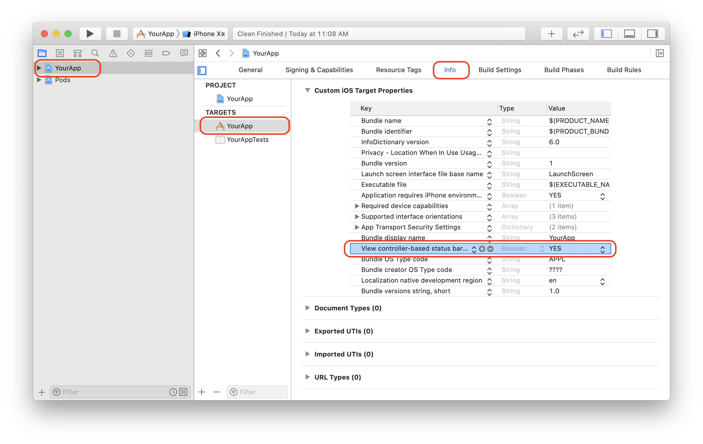
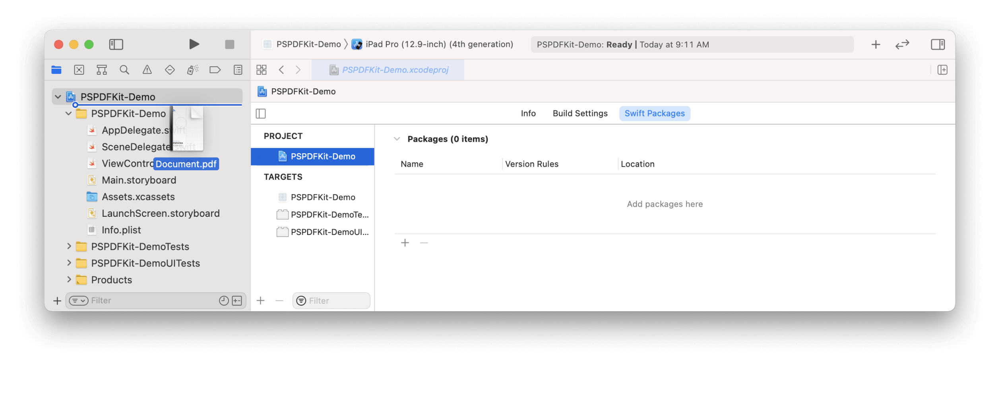

# Nutrient React Native SDK


This library requires a valid license of the Nutrient SDK. Licenses are per platform.

Work with a React Native PDF viewer SDK engineered for the best possible user and developer experience. Whether you need high-fidelity PDF rendering, annotation tools, digital signatures, or form filling, our React Native PDF SDK gives you complete control over PDF viewing and editing within your app.

### Nutrient

The [Nutrient SDK](https://nutrient.io/) is a framework that allows you to view, annotate, sign, and fill PDF forms on iOS, Android, Windows, macOS, and Web.

[Nutrient Collaboration ](https://www.nutrient.io/sdk/solutions/collaboration) adds real-time collaboration features to seamlessly share, edit, and annotate PDF documents.

# Support, Issues and License Questions

Nutrient offers support for customers with an active SDK license via https://support.nutrient.io/hc/en-us/requests/new.

Are you evaluating our SDK? That's great, we're happy to help out! The Nutrient React Native SDK is a commercial product and requires the purchase of a license key when used in production. By default, this library will initialize in demo mode, placing a watermark on each PDF and limiting usage to 60 minutes.

To purchase a license for production use, please reach out to us via https://www.nutrient.io/sdk/contact-sales.

To initialize the Nutrient React Native SDK using a license key, call either of the following before using any other Nutrient SDK APIs or features:

To set the license key for both Android and iOS, use:

```
Nutrient.setLicenseKeys('YOUR_REACT_NATIVE_ANDROID_LICENSE_KEY_GOES_HERE', 'YOUR_REACT_NATIVE_IOS_LICENSE_KEY_GOES_HERE');
```

To set the license key for the currently running platform, use:

```
Nutrient.setLicenseKey('YOUR_REACT_NATIVE_LICENSE_KEY_GOES_HERE');
```

### Requirements

- A [development environment](https://reactnative.dev/docs/environment-setup) for running React Native projects using the React Native CLI. If you’re using Expo, [check out our blog post](https://www.nutrient.io/blog/how-to-use-pspdfkit-for-react-native-with-expo/) on the topic.
- React Native 0.87 or later (Expo SDK 58 or later)

#### iOS

- The [latest stable version of Xcode](https://apps.apple.com/us/app/xcode/id497799835?mt=12)
- The [latest stable version of CocoaPods](https://github.com/CocoaPods/CocoaPods/releases). If you don’t already have CocoaPods installed, follow the [CocoaPods installation guide](https://guides.cocoapods.org/using/getting-started.html#installation) to install CocoaPods on your Mac.

#### Android

- The [latest stable version of Android Studio](https://developer.android.com/studio)
- The [Android NDK](https://developer.android.com/studio/projects/install-ndk)
- An [Android Virtual Device](https://developer.android.com/studio/run/managing-avds.html) or a hardware device
- Android Gradle Plugin 9.1 or later and Kotlin 2.4.10 or later. React Native 0.87 and later already use Android Gradle Plugin 9.2.1 and Gradle 9.4.1.
- `compileSdk` 37 with `compileSdkMinor` 1 (the `android-37.1` platform), and `minSdk` 24

> If your app minifies release builds, avoid Android Gradle Plugin 9.3.0–9.3.3 and 9.4.0–9.4.1. Their R8 removes a null check in `react-native-screens` ([b/558217403](https://issuetracker.google.com/issues/558217403)), so the app crashes at launch. Stay on 9.2.1, or pin R8 9.4.29 or later.

### Installation

To install the Nutrient React Native SDK, run `yarn add @nutrient-sdk/react-native` in your project directory or `npm install @nutrient-sdk/react-native` if you’re using `npm`.

### Expo config plugin (Android)

When using Expo prebuild/dev client, add the package as a plugin so Android `AppTheme` is switched to a MaterialComponents-compatible theme, and the generated Android project uses Kotlin 2.4.10 or later and compiles against android-37.1 or later:

```js
// app.config.js
export default {
  expo: {
    plugins: ['@nutrient-sdk/react-native'],
  },
};
```

The plugin defaults to an edge-to-edge-friendly DayNight parent (`@style/NutrientRN.AppTheme`). You can override it:

```js
// app.config.js
export default {
  expo: {
    plugins: [
      [
        '@nutrient-sdk/react-native',
        {
          androidThemePreset: 'fullNutrient',
          // or provide a fully custom parent:
          // androidAppThemeParent: '@style/YourCustomTheme',
        },
      ],
    ],
  },
};
```

If you also set `android.kotlinVersion` with `expo-build-properties`, list `@nutrient-sdk/react-native` before it in `plugins`, or set 2.4.10 or later there. Otherwise the version from `expo-build-properties` replaces the one this plugin sets.

After updating app config, run `npx expo prebuild -p android` (or rebuild with EAS).

### Expo on iOS

The SDK needs iOS 17 or later, and Expo SDK 58 apps default to iOS 16.4, so `pod install` can't resolve `nutrient-sdk-react-native`. Raise the deployment target with `expo-build-properties`:

```js
// app.config.js
export default {
  expo: {
    plugins: [
      '@nutrient-sdk/react-native',
      ['expo-build-properties', { ios: { deploymentTarget: '17.0' } }],
    ],
  },
};
```

### Getting Started

See our [Getting Started on React Native guide](https://www.nutrient.io/getting-started/react-native/?react-native-platform=android-ios&project=new-project) to integrate the SDK into your new or existing application, or follow the steps below:

1. In the terminal app, change the current working directory to the location you wish to save your project. In this example, we’ll use the `~/Documents` directory:

   ```bash
   cd ~/Documents
   ```

1. Create the React Native project by running the following command:

   ```bash
   npx @react-native-community/cli init NutrientDemo
   ```

1. In the terminal app, change the location of the current working directory inside the newly created project:

   ```bash
   cd NutrientDemo
   ```

1. Add the Nutrient React Native SDK:

   ```bash
   yarn add @nutrient-sdk/react-native
   ```

1. Install all the dependencies for the project:

   ```bash
   yarn install
   ```

1. Open your project's `build.gradle` file:

   ```bash
   open android/build.gradle
   ```

1. Make sure Maven Central is in your repositories — Nutrient Android SDK is published there, so no custom repository is needed:

   ```diff
     allprojects {
       repositories {
         mavenLocal()
   +     mavenCentral()
       }
     }
   ```

   > If you previously added `https://my.nutrient.io/maven/` for the Nutrient SDK, you can remove it. Keep it only if you also use an add-on that isn't on Maven Central yet, such as OCR (`io.nutrient:nutrient-ocr`).

1. Raise Kotlin in your project's `android/build.gradle`. Nutrient's Kotlin metadata is built with Kotlin 2.4. The React Native template leaves the Kotlin Gradle plugin unversioned, so it has to be given the version as well:

   ```diff
     buildscript {
       ext {
   -     kotlinVersion = "2.2.0"
   +     kotlinVersion = "2.4.10"
       }
       dependencies {
         classpath("com.android.tools.build:gradle")
         classpath("com.facebook.react:react-native-gradle-plugin")
   -     classpath("org.jetbrains.kotlin:kotlin-gradle-plugin")
   +     classpath("org.jetbrains.kotlin:kotlin-gradle-plugin:$kotlinVersion")
       }
     }
   ```

   Keep the Android Gradle Plugin 9.2.1 and Gradle 9.4.1 that React Native 0.87 and later come with.

1. Open the app’s build.gradle file and set the compile SDK's minor version:

   ```diff
   ...
     android {
       compileSdk rootProject.ext.compileSdkVersion
   +   // Nutrient's AAR metadata requires the android-37.1 platform, so the minor version
   +   // has to be set as well.
   +   compileSdkMinor 1
   ...
   ```

   > `compileSdkVersion` in your project's `ext` block is 37 in React Native 0.87 and later. If you lowered it, set `compileSdk 37` in the app module.

1. Open your project’s Podfile:

   ```bash
   open ios/Podfile
   ```

1. Update the minimum iOS platform version in the Podfile:

   ```diff
   ...
   - platform :ios, min_ios_version_supported
   + platform :ios, '17.0'
   ...
   ```

1. Change the location of the current working directory to the `ios` folder:

   ```bash
   cd ios
   ```

1. Install the CocoaPods dependencies:

   ```bash
   pod install
   ```

1. Open your project’s Workspace in Xcode:

   ```bash
   open NutrientDemo.xcworkspace
   ```

1. Make sure the deployment target is set to 17.0 or higher:

   

1. Change View controller-based status bar appearance to `YES` in your project’s `Info.plist`:

   

1. Add the PDF document you want to display to your application by dragging it into your project. On the dialog that’s displayed, select Finish to accept the default integration options. You can use <a href="https://www.nutrient.io/downloads/pspdfkit-ios-quickstart-guide.pdf" download="Document.pdf">this QuickStart Guide PDF</a> as an example.

   

1. Change the location of the current working directory back to the root project folder:

   ```bash
   cd ..
   ```

1. Create the `assets` directory:

   ```bash
   mkdir android/app/src/main/assets
   ```

1. Copy a PDF document into your Android assets directory:

   ```bash
   cp ~/Downloads/Document.pdf android/app/src/main/assets/Document.pdf
   ```

1. Open your `App.tsx` file:

   ```bash
   open App.tsx
   ```

1. Replace the entire contents of `App.tsx` with the following code snippet:

   ```typescript
   import React, { Component } from 'react';
   import { Platform } from 'react-native';
   import NutrientView from '@nutrient-sdk/react-native';
   import type { Nutrient as NutrientModule } from '@nutrient-sdk/react-native';
   import { NativeModules } from 'react-native';

   const Nutrient: NutrientModule = NativeModules.Nutrient;
   Nutrient.setLicenseKey(null);

   const DOCUMENT =
     Platform.OS === 'ios'
       ? 'Document.pdf'
       : 'file:///android_asset/Document.pdf';
   export default class NutrientDemo extends Component<{}> {
     render() {
       var pdfRef: React.RefObject<NutrientView | null> = React.createRef();
       return (
         <NutrientView
           document={DOCUMENT}
           configuration={{
             showThumbnailBar: 'scrollable',
             pageTransition: 'scrollContinuous',
             scrollDirection: 'vertical',
           }}
           ref={pdfRef}
           fragmentTag="PDF1"
           style={{ flex: 1 }}
         />
       );
     }
   }
   ```

1. The app is now ready to launch! Go back to the terminal app and run:

   ```bash
   react-native run-ios
   ```

   ```bash
   react-native run-android
   ```

### Running the example Catalog application

Take a look at the instructions to get started [here](/samples/Catalog/README.md#running-the-catalog-on-ios) for iOS and [here](/samples/Catalog/README.md#running-the-catalog-on-android) for Android.

### Configuration

The behaviour of the `NutrientView` component can be customized using the configuration object. Refer to the [`PDFConfiguration`](https://www.nutrient.io/api/react-native/PDFConfiguration.html) API documentation. The `PDFConfiguration` object can be passed as a prop when creating the `NutrientView` component, or a parameter when using the `Nutrient.present()` Native Module API.

```typescript
const configuration: PDFConfiguration = {
  showPageLabels: false,
  pageTransition: 'scrollContinuous',
  scrollDirection: 'vertical',
  showThumbnailBar: 'scrollable',
};
```

## Updates

Some releases contain changes that require updates to your project settings or application code. Take a look at our [Upgrade and Migration guides](https://www.nutrient.io/guides/react-native/upgrade/) after updating your Nutrient React Native SDK dependency.

# Troubleshooting

For Troubleshooting common issues you might encounter when setting up the Nutrient React Native SDK, please refer to the [Troubleshooting](https://www.nutrient.io/guides/react-native/troubleshoot/) section.

## License

This project can be used for evaluation or if you have a valid Nutrient license.
All items and source code Copyright © 2010-2026 PSPDFKit GmbH.

See [LICENSE](./LICENSE) for details.
